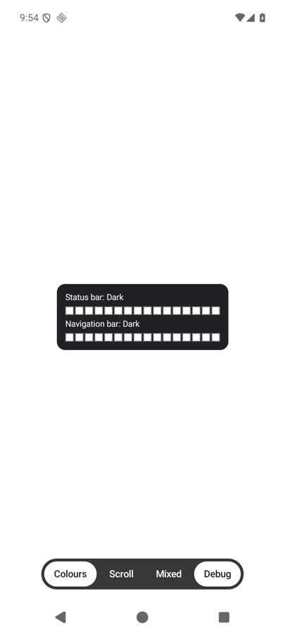
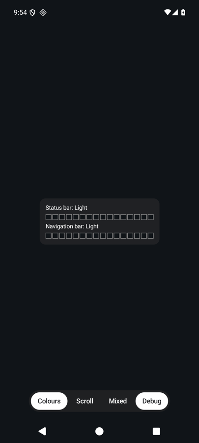
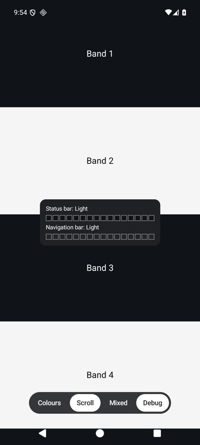
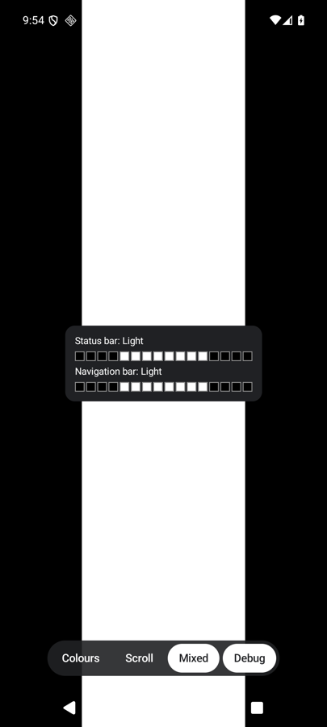

# EdgeChameleon

Compose Multiplatform library that switches the status bar and navigation bar icons between light and dark, based on
the content behind the bars.

## Quick start

> Not published yet. These steps apply from the first release on.

**1. Add the dependency**

```kotlin
repositories {
    mavenCentral()
}

dependencies {
    implementation("dev.schattauer.edgechameleon:edgechameleon:<version>")
}
```

**2. Add the modifier to the root of your app content, and draw edge-to-edge**

```kotlin
class MainActivity : ComponentActivity() {
    override fun onCreate(savedInstanceState: Bundle?) {
        enableEdgeToEdge()
        super.onCreate(savedInstanceState)
        setContent {
            MyApp(Modifier.fillMaxSize().edgeChameleon())
        }
    }
}
```

The icons now follow your content.

## Screenshots

Taken from the sample app with its debug panel on, which shows the 16 sampled cells of each bar and the chosen icons.

| Light content | Dark content | Scrolling | Mixed content |
|---|---|---|---|
|  |  |  |  |
| Dark icons | Light icons | Follows what is behind each bar | The cells where icons sit decide, so an icon over a different colour can lose contrast |

## Options

```kotlin
val state = remember { EdgeChameleonState() }

Modifier.edgeChameleon(
    enabled = true,                 // false restores the original icons and stops sampling
    forcedIcons = BarIcons.Light,   // uses these icons and stops sampling
    statusBar = true,               // whether the status bar is handled
    navigationBar = true,           // whether the navigation bar is handled
    state = state,                  // state.statusBarIcons and state.navigationBarIcons hold the current result
)
```

`EdgeChameleonTuning` sets the sampling rate, cell count, contrast threshold, hysteresis and zone weights. It is marked
`@ExperimentalEdgeChameleonApi`.

## Behaviour

- The content is sampled after it changes, at most 10 times per second, and not at all on a static screen.
- Each bar is reduced to 16 cells, and the cells vote for the icon colour with the better contrast. Cells where icons
  usually sit count three times.
- Only Compose content inside the modifier is sampled.
- Sampling pauses while another window, such as a `Dialog`, has the focus, and the icons keep their tint until then.
- A full-screen `Dialog` has its own bars: add the modifier to the content of the dialog as well. It has no effect in a
  dialog that does not reach the bars.
- With gesture navigation, the navigation bar is not handled.
- While active, the navigation bar contrast scrim is turned off. It is restored when the modifier is disabled or removed.
- Disabling or removing the modifier restores the icons the app had before the library first changed them. Changes the
  app makes to the icons while the modifier is active are replaced.

## Platforms

| Platform | Behaviour |
|---|---|
| Android 9 (API 28) and newer | Samples the content and sets the icons |
| Android below 9, iOS, macOS, desktop (JVM), web (JS and Wasm) | Only draws the content; the options have no effect |

## Sample

`sample/` holds an Android app with a colour screen, scrolling bands and mixed backgrounds. Its debug toggle shows the
sampled cells and the current result.

```
./gradlew :sample:androidApp:installDebug
```

## Tests and formatting

- Unit tests: `./gradlew :edgechameleon:testAndroidHostTest :edgechameleon:jvmTest`
- Device tests, on a running emulator or device: `./gradlew :edgechameleon:connectedAndroidDeviceTest`
- Check the formatting: `./gradlew ktfmtCheck ktfmtCheckScripts`
- Format the code: `./gradlew ktfmtFormat ktfmtFormatScripts`
- Check the public API against `edgechameleon/api`: `./gradlew :edgechameleon:checkKotlinAbi`. After a deliberate API
  change, update the dump with `./gradlew :edgechameleon:updateKotlinAbi`.

## More

- [CHANGELOG.md](CHANGELOG.md): what changed in each version
- [CONTRIBUTING.md](CONTRIBUTING.md): development setup and pull requests
- [SECURITY.md](SECURITY.md): how to report a vulnerability
- [RELEASE.md](RELEASE.md): how a release is made

## License

[Apache License 2.0](LICENSE)
